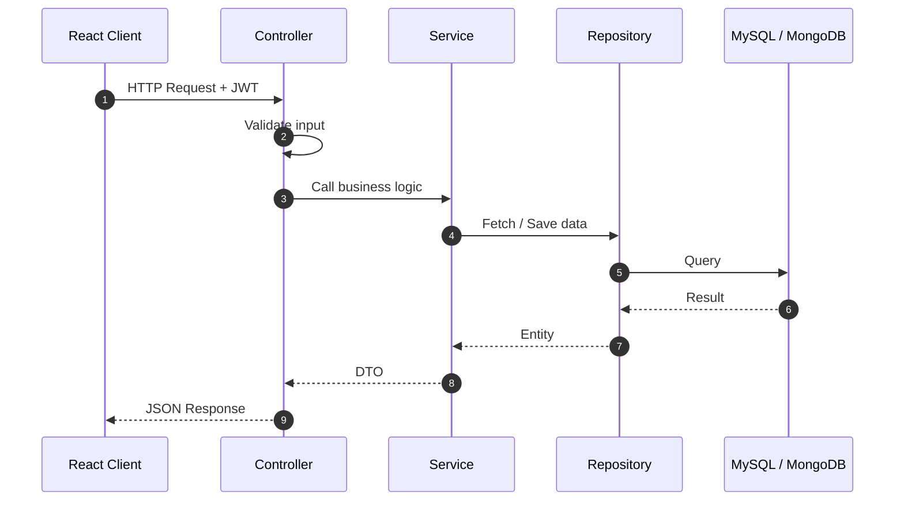
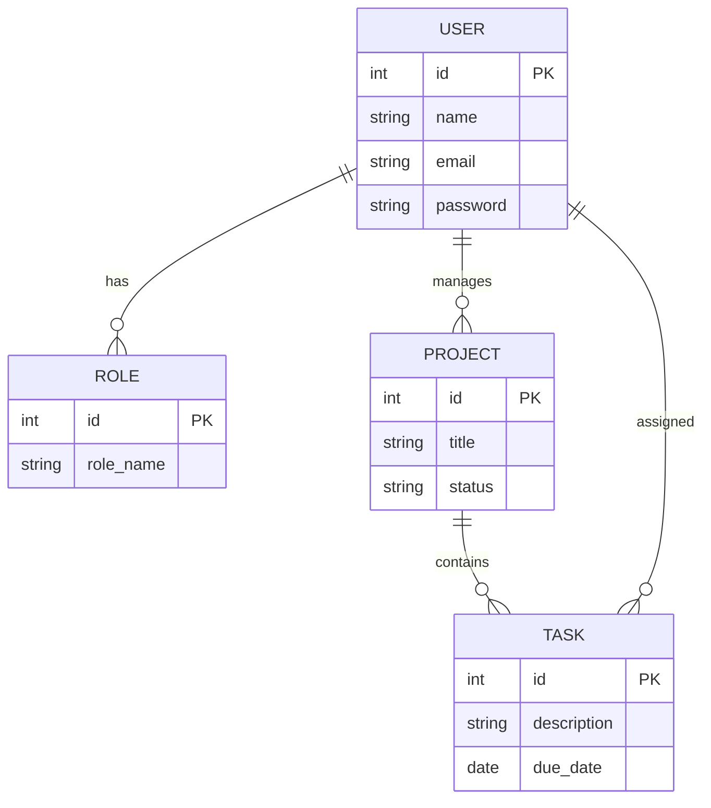

```text
  .   ____          _            __ _ _
 /\\ / ___'_ __ _ _(_)_ __  __ _ \ \ \ \
( ( )\___ | '_ | '_| | '_ \/ _` | \ \ \ \
 \\/  ___)| |_)| | | | | || (_| |  ) ) ) )
  '  |____| .__|_| |_|_| |_\__, | / / / /
 =========|_|==============|___/=/_/_/_/
 :: SaravanakumarApplication ::        (v1.0.0)

 Started SaravanakumarApplication in 0.8 seconds
 Tomcat started on port(s): 8080 (http)
 Profile active: developer | Mode: always-learning
```

<p align="center">
  
</p>

<p align="center">
  <a href="https://saravanakumar-portfolio-sable.vercel.app/"></a>
  <a href="https://www.linkedin.com/in/saravanakumar1912/"></a>
  <a href="mailto:saravanakumars3019@gmail.com"></a>
  
  
  
</p>

---

## 📋 `GET /actuator/health`

```json
{
  "status": "UP",
  "developer": "Saravanakumar S",
  "role": "Java Full Stack Developer",
  "education": "B.Tech - Computer Science & Business Systems",
  "components": {
    "backend":  { "status": "UP", "details": ["Java", "Spring Boot", "Node.js", ".NET"] },
    "frontend": { "status": "UP", "details": ["React", "JavaScript", "HTML", "CSS"] },
    "database": { "status": "UP", "details": ["MySQL", "MongoDB"] },
    "devops":   { "status": "UP", "details": ["Git", "Docker"] },
    "learning": { "status": "IN_PROGRESS", "details": ["Microservices", "Kubernetes", "AWS"] }
  }
}
```

---

## ⚙️ `application.yml`

```yaml
developer:
  name: Saravanakumar S
  role: Java Full Stack Developer
  focus:
    - REST API Development
    - Database Design
    - Clean Architecture
    - System Design
  goal: Build scalable products used by millions
  motto: "Code. Learn. Build. Repeat."

server:
  port: 8080

contact:
  email: saravanakumars3019@gmail.com
  open-to-work: true
```

---

## 🔌 API Endpoints

| Method | Endpoint | Description | Status |
|:--:|:--|:--|:--:|
| `GET` | `/api/developer/skills` | Java, Spring Boot, React, Node.js, .NET, MySQL, MongoDB |  |
| `GET` | `/api/developer/projects` | 6 full stack and IoT projects (listed below) |  |
| `POST` | `/api/developer/hire` | Open to Java Full Stack and Backend roles |  |
| `PUT` | `/api/developer/skills/learning` | Microservices, Docker, Kubernetes, AWS |  |

---

## 🏛 Layered Architecture I Follow



---

## 🗄 Typical Database Design



---

## 🚀 Project Modules

| # | Module | Tech Focus | Key Features |
|:--:|:--|:--|:--|
| 1 | **CRM for Engineering Works** | Full Stack | Employee and client management, project tracking, auth and roles |
| 2 | **IoT IV Infusion Monitoring** | IoT + Web | Real-time fluid monitoring, alerts, sensor integration |
| 3 | **Campus Lost & Found Portal** | Web | Student login, report, search and claim items |
| 4 | **Agro Connect** | Web | Farmer-to-customer marketplace, direct buyer communication |
| 5 | **Smart Waste Management** | Web + Data | Bin monitoring dashboard, data visualization |
| 6 | **Decentralized Blood Donor App** | Web + Security | Secure auth, blood search, emergency notifications |

---

## 🐳 Deployment Pipeline (Learning)

```dockerfile
# Dockerfile
FROM eclipse-temurin:17-jre
WORKDIR /app
COPY target/app.jar app.jar
EXPOSE 8080
ENTRYPOINT ["java", "-jar", "app.jar"]
```

```bash
docker build -t saravanakumar/app:1.0 .
docker run -p 8080:8080 saravanakumar/app:1.0
kubectl apply -f deployment.yaml
```

---

## 📜 `git log --oneline` (Learning Path)

```text
a1f4c92 (HEAD -> main) Learning: AWS Cloud
7be03d1 Learning: Kubernetes orchestration
c92e8a7 Learning: Docker containerization
4d1b6f0 Learning: Microservices architecture
9e3a7c5 Built: Spring Boot REST APIs with JWT
2f8d1b4 Built: React full stack applications
b6c0e93 Started: Java, OOP and DSA
```

---

## 📊 Metrics

<p align="center">
  
  
</p>

<p align="center">
  
</p>

<p align="center">
  
</p>

---

## 🛠 Dependencies (`pom.xml` style)

<p align="center">
  
</p>

---

## 📫 `POST /api/contact`

```http
POST /api/contact HTTP/1.1
Host: saravanakumar-portfolio-sable.vercel.app
Content-Type: application/json

{
  "to": "saravanakumars3019@gmail.com",
  "linkedin": "linkedin.com/in/saravanakumar1912",
  "message": "Let's build something scalable together."
}
```


