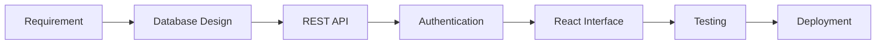

  

  
  
  
  

---

## 👨‍💻 About

I am a **Full Stack Developer** who builds secure, scalable and user-friendly web applications, covering everything from database design and REST APIs to responsive user interfaces.

<table>
  <tr>
    <td width="50%" valign="top">

**🎓 Education**  
B.Tech, Computer Science & Business Systems

**💼 Role**  
Full Stack Developer

**🎯 Goal**  
Build scalable products used by millions of people

    </td>
    <td width="50%" valign="top">

**⚡ Strengths**  
REST APIs · Database Design · System Design · Clean Architecture

**🌱 Learning**  
Microservices · Docker · Kubernetes · AWS

**💬 Motto**  
*Code. Learn. Build. Repeat.*

    </td>
  </tr>
</table>

---

## 🧰 Tech Stack

<table>
  <tr>
    <td align="center" width="25%"><b>Frontend</b></td>
    <td align="center" width="25%"><b>Backend</b></td>
    <td align="center" width="25%"><b>Database</b></td>
    <td align="center" width="25%"><b>DevOps & Tools</b></td>
  </tr>
  <tr>
    <td align="center"></td>
    <td align="center"></td>
    <td align="center"></td>
    <td align="center"></td>
  </tr>
</table>

---

## ⚙️ How I Build Applications

---

## 🚀 Featured Projects

| Project | What it does | Key Features |
|:--|:--|:--|
| 🏗 **CRM for Engineering Works** | Customer relationship management system | Employee and client management, project tracking, authentication |
| 💉 **IoT IV Infusion Monitoring** | Smart healthcare monitoring | Real-time monitoring, alerts, sensor data integration |
| 🎒 **Campus Lost & Found Portal** | Lost and found management for campus | Student login, report, search and claim items |
| 🌾 **Agro Connect** | Farmer-to-customer marketplace | Product listings, direct buyer communication |
| ♻️ **Smart Waste Management** | Waste collection for communities | Bin monitoring dashboard, data visualization |
| 🩸 **Decentralized Blood Donor App** | Connects donors and recipients | Secure authentication, blood search, emergency alerts |

---

## 📊 GitHub Analytics

  
  

  

  

---

## 📚 Currently Focused On

- Full stack web applications with React and Node.js
- Building and securing REST APIs
- Docker and Kubernetes
- AWS cloud services
- System design and open source contributions

---

## 📫 Let's Connect

  Open to full stack opportunities, collaborations and open source work.

  📧 <b>saravanakumars3019@gmail.com</b> 
  🌐 <a href="https://saravanakumar-portfolio-sable.vercel.app/">saravanakumar-portfolio-sable.vercel.app</a> 
  💼 <a href="https://www.linkedin.com/in/saravanakumar1912/">linkedin.com/in/saravanakumar1912</a>

